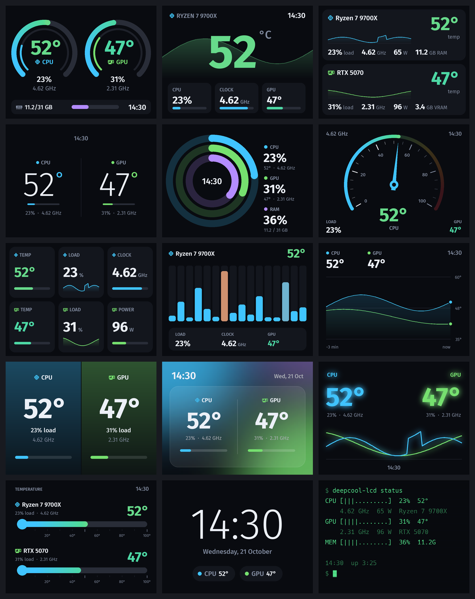
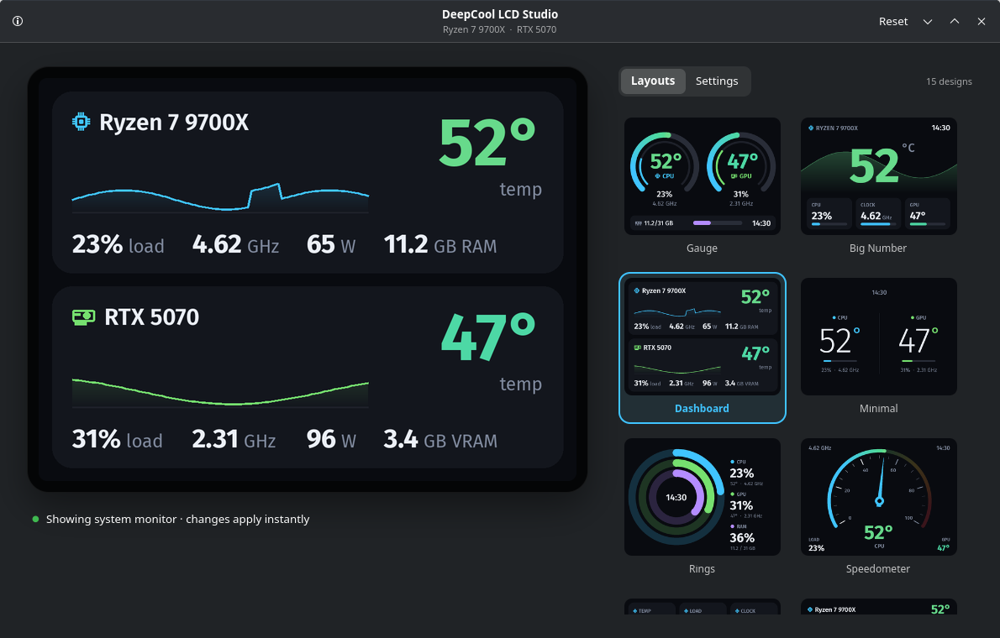

# DeepCool LCD

**Custom screens for the LCD of DeepCool LM-series AIO coolers on Linux.** Live CPU and GPU
temperatures, load, clocks, power and memory, in 15 layouts you can color to match your build,
plus a desktop app to customize everything.

[](https://github.com/zazazaxky-m/deepcool-lcd/actions/workflows/ci.yml)
[](LICENSE)



> Unofficial project, not affiliated with or endorsed by DeepCool. "DeepCool" is a trademark of
> its owner and is used here only to say which hardware this works with.

## Features

- **15 layouts**: Gauge, Big Number, Dashboard, Minimal, Rings, Speedometer, Tiles, Cores,
  Timeline, Split, Aurora, Neon, Thermometer, Clock and Terminal
- **Accurate readings**: CPU temperature on AMD (`k10temp`, `zenpower`) and Intel (`coretemp`),
  fastest-core clock, per-thread load, CPU package power, RAM; GPU temperature, load, clock, power
  and VRAM on NVIDIA and AMD
- **Your look**: CPU/GPU accent colors, background (dark or light), °C/°F, 12/24-hour clock,
  custom device names
- **Brightness from 10 to 100%** and a **refresh interval** of 0.5 to 5 seconds
- **Pictures and solid colors** (black works as a screen-off)
- **DeepCool LCD Studio**: live preview, layout gallery and all settings, applied instantly
- **`deepcool-lcd` command line** for scripts and keyboard shortcuts
- **Light and safe**: about 1% of one CPU core at a 2-second refresh, running as its own
  unprivileged, sandboxed service



## Supported hardware

| | |
|---|---|
| Cooler | DeepCool **LM360** (tested). Other LM-series coolers that show up as USB `3633:0026` should work; please report yours |
| CPU | AMD Ryzen / EPYC, Intel Core |
| GPU | NVIDIA (proprietary driver), AMD (`amdgpu`). Intel Arc is not read yet |
| System | Any Linux distribution with systemd |

Check that your cooler is there with `lsusb | grep 3633`.

## Install

### Arch Linux, Manjaro, EndeavourOS, CachyOS

Build the package from the PKGBUILD in this repo (the AUR package is coming soon):

```bash
git clone https://github.com/zazazaxky-m/deepcool-lcd
```

```bash
cd deepcool-lcd/packaging/arch && makepkg -si
```

```bash
sudo systemctl enable --now deepcool-lcd
```

`packaging/arch-git` builds the latest code instead.

### Ubuntu, Debian, Linux Mint, Pop!_OS

Download `deepcool-lcd_<version>_all.deb` from the [latest release](https://github.com/zazazaxky-m/deepcool-lcd/releases/latest), then:

```bash
sudo apt install ./deepcool-lcd_*_all.deb
```

The service starts by itself.

### Fedora, openSUSE

Download `deepcool-lcd-<version>.noarch.rpm` from the [latest release](https://github.com/zazazaxky-m/deepcool-lcd/releases/latest), then:

```bash
sudo dnf install ./deepcool-lcd-*.noarch.rpm
```

(`sudo zypper install ./deepcool-lcd-*.noarch.rpm` on openSUSE.) The service starts by itself.

### Any other distribution

The installer uses your package manager (pacman, apt, dnf or zypper) for the dependencies,
installs into `/usr/local` and starts the service:

```bash
curl -fsSL https://raw.githubusercontent.com/zazazaxky-m/deepcool-lcd/main/install.sh | sudo bash
```

Or from a clone: `sudo ./install.sh`, and `sudo ./install.sh --uninstall` to remove it.

### Requirements

The packages pull these in for you.

| | |
|---|---|
| Service | Python 3.9+, pyusb, psutil, Pillow 9.1+, systemd |
| Studio app | GTK 4.12+ and PyGObject: Ubuntu 24.04+, Debian 13+, Fedora 39+, openSUSE Tumbleweed, Arch |

On older releases (e.g. Ubuntu 22.04) the service and the command line work, and Studio doesn't.

## Use it

Open **DeepCool LCD Studio** from your app menu. Pick a layout in the **Layouts** tab, and
colors, brightness and the rest under **Settings**; the LCD follows instantly.

From a terminal:

```bash
deepcool-lcd status                      # what the LCD shows and its settings
deepcool-lcd theme                       # list the layouts
deepcool-lcd theme neon                  # switch layout
deepcool-lcd brightness 60               # backlight to 60% (or: up / down)
deepcool-lcd interval 1                  # refresh every second
deepcool-lcd set cpu_color=#ff5c8a temp_unit=F clock_24h=false
deepcool-lcd image ~/Pictures/logo.png   # show a picture
deepcool-lcd solid "#000000"             # black screen
deepcool-lcd monitor                     # back to the stats
deepcool-lcd preview out.png --theme rings --scale 2   # render without the LCD
```

### Settings

Saved in `/etc/deepcool-lcd/config.json` by the service.

| Setting | Values | Default |
|---|---|---|
| `theme` | `gauge` `hero` `dashboard` `minimal` `rings` `speedo` `tiles` `cores` `timeline` `split` `aurora` `neon` `thermo` `clock` `terminal` | `gauge` |
| `cpu_color`, `gpu_color` | `#rrggbb` | `#40c4ff`, `#76e06f` |
| `background` | `#rrggbb`; light colors switch the text to dark | `#090b10` |
| `temp_unit` | `C`, `F` | `C` |
| `clock_24h` | `true`, `false` | `true` |
| `cpu_label`, `gpu_label` | up to 24 characters; empty uses the detected model | empty |
| `hero_focus` | `cpu`, `gpu`: the main reading in Big Number and Speedometer | `cpu` |
| `brightness` | 10–100 | 100 |
| `interval` | 0.5, 1, 2, 3, 4, 5 (seconds) | 2 |

### Coming from deepcool-lm

The packages and the installer stop the old `deepcool-lm` service (only one program can drive the
LCD) and carry over its settings from `/etc/deepcool-lm/config.json`. Remove the old package
afterwards, e.g. `sudo pacman -R deepcool-lm`.

## How it works

The `deepcool-lcd` service reads the sensors, draws the layout and sends it to the LCD over USB
every refresh. Studio and the command line talk to it over a local socket; Studio's preview is
drawn by the service itself, so it always matches the LCD.

Security, in short:

- The service runs as its own **unprivileged `deepcool-lcd` user**, sandboxed by systemd (read-only
  system, no capabilities, no home access).
- A **udev rule** gives that user access to the LCD (USB `3633:0026`) and read access to the CPU
  energy counter (`/sys/class/powercap/intel-rapl:0/energy_uj`) for the power reading. That counter
  is root-only by default because of the PLATYPUS side channel (CVE-2020-8694); the rule opens it
  to the service's group only.
- Any local user can change what the LCD shows, like other desktop settings. The service only
  accepts settings and raw pixels: **pictures are decoded by the app or command line**, never by
  the service.

The USB protocol is documented in [docs/PROTOCOL.md](docs/PROTOCOL.md).

## Troubleshooting

| Problem | Try |
|---|---|
| Nothing on the LCD | `systemctl status deepcool-lcd` and `journalctl -u deepcool-lcd -b` |
| "No DeepCool LM-series LCD found" | Is the cooler's USB cable connected to a motherboard header? `lsusb \| grep 3633` |
| "Permission denied opening the LCD" | `sudo udevadm trigger --subsystem-match=usb --action=add`, or replug / reboot |
| "The LCD is busy" | Another driver is running: `sudo systemctl disable --now deepcool-lm` |
| No CPU watts | `sudo udevadm trigger --subsystem-match=powercap --action=add` |
| GPU shows 0 | NVIDIA needs the proprietary driver (`nvidia-smi` must work); Intel Arc isn't supported yet |
| Studio says the service isn't running | `sudo systemctl enable --now deepcool-lcd` |

## Development

```bash
git clone https://github.com/zazazaxky-m/deepcool-lcd && cd deepcool-lcd
make test                                       # unit tests (no LCD needed)
python3 -m deepcool_lcd preview out.png         # render with your live readings
make screenshots                                # regenerate docs/screenshots
```

New layouts go in `deepcool_lcd/themes.py` (draw with the helpers in `render.py`) and get a name
in `config.THEME_NAMES`. Bug reports, layouts and USB captures from other LM-series models are
welcome.

## Credits

- [deepcool-lm](https://github.com/daedlock/deepcool-lm) by dlock: the original driver and the
  captured USB commands this project builds on
- [Fira Sans](https://github.com/mozilla/Fira) (SIL OFL 1.1) and [Hack](https://github.com/source-foundry/Hack)
  (MIT / Bitstream Vera License), bundled for the LCD

## License

MIT, see [LICENSE](LICENSE). The bundled fonts keep their own licenses (in `data/fonts/`).
